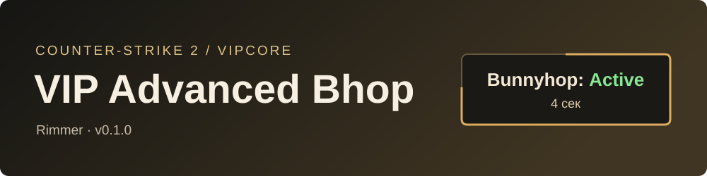

# VIP_Advanced_Bhop

[English](#english) · [Русский](#русский) · [PanoramaMenuManager website](https://genesis-cs.space/menuconstructor/index.html)

## English

**VIP Advanced Bhop 0.1.0** by **Rimmer** brings VIP_Bhop from CS:GO to CS2. Hold jump to bunny hop while your VIP group has access. Each group can have its own cooldown. The server controls how long players can hop and how fast they can move.

### Requirements

- Linux x64 CS2 server with [CounterStrikeSharp](https://github.com/roflmuffin/CounterStrikeSharp) **1.0.380** and [Fabius VIPCore](https://github.com/partiusfabaa/cs2-VIPCore) **2.0.3**.
- For the countdown and notification icons, install **PMM_VIPCore 0.1.6 with Bunnyhop HUD support**, [PanoramaMenuManager](https://github.com/RRimmer/PanoramaMenuManagerCS2) and the matching client addon. Servers running VIPCore alone can use chat.

### Features

- Timed or round-long access, a horizontal speed limit, an optional lockout after enemy damage and pistol-round restrictions.
- Chat messages use the player’s language and VIPCore’s `vip.Prefix`.
- The Panorama HUD shows `Active` or `Inactive` with a rectangular countdown. A separate MenuManager toast explains why the state changed. Players can choose their display mode in `!vip` when the server allows it.

### Install from a release

1. Unload the stock `VIP_Bhop` module if installed. Both modules register the VIP feature `Bhop`.
2. Extract `addons/` from the ZIP into `game/csgo/`. Keep your existing JSONC when upgrading.
3. In VIPCore’s `vip.json`, add `"Bhop": 1` to a group for the global cooldown, `"Bhop": 5` for a five-second cooldown, or `"Bhop": 0` for immediate access after freeze time.
4. Load `VIP_Advanced_Bhop`. It sets `sv_legacy_jump 1` server-wide on load and map start. To disable Bhop in pistol rounds, add `"Bhop"` to `DisableOnPistolRound` in `vip_core.json`.

### Configuration

The module creates `addons/counterstrikesharp/configs/plugins/VIPCore/Modules/VIP_Advanced_Bhop.jsonc` on first load if missing. [Commented configuration](configs/plugins/VIPCore/Modules/VIP_Advanced_Bhop.jsonc)

| Setting | Default | Effect |
| --- | --- | --- |
| `bhop_allowtime` | `5` | Seconds of access. Zero grants access until round end. |
| `bhop_locktime` | `15` | Cooldown in seconds for groups with `"Bhop": 1`. |
| `bhop_max_speed` | `0` | Zero caps horizontal speed at 300 units/s. A positive number sets the cap. −1 removes the module’s cap. |
| `bhop_info` | `2` | 0 off, 1 chat, 2 Panorama, 3 both. Falls back to chat if PMM is absent. |
| `bhop_display_mode` | `3` | 1 toast, 2 countdown, 3 both. |
| `bhop_hud_position` | `0` | Under the radar by default. Alternatives are below the score, below the crosshair or above HP. |
| `bhop_hud_autohide_seconds` | `5` | Hide an indefinite state after this delay. Zero keeps it visible. |

To enable personal display settings, set `bhop_player_display_settings` to `true` and add `"BhopHud": 1` to the appropriate VIP groups.

### Repository layout

| Path | Contents |
| --- | --- |
| `VIP_Advanced_Bhop/` | Plugin lifecycle, movement, configuration and player preferences |
| `VIP_Advanced_Bhop/lang/` | Player-facing translations |
| `configs/plugins/VIPCore/Modules/` | Default JSONC |
| `lib/VipCoreApi/` | VIPCore 2.0.3 build reference and its MIT license |
| `.github/workflows/` | Build and ZIP packaging |

### Build

With .NET SDK 10, run `dotnet build VIP_Advanced_Bhop.sln -c Release`. On Windows, `pack.cmd` produces `VIP_Advanced_Bhop-CS2.zip` in the repository root. The server uses the shared API installed by VIPCore.

[Installation guide](INSTALL.md) · [Changelog](CHANGELOG.md) · [License](LICENSE)

---

## Русский

**VIP Advanced Bhop 0.1.0** — порт VIP_Bhop из CS:GO для CS2 от **Rimmer**. Пока группе доступен Bhop, игрок может удерживать пробел для распрыжки. Администратор задаёт задержку для каждой группы, время доступа и предел скорости.

### Что нужно установить

- Сервер CS2 на Linux x64, [CounterStrikeSharp](https://github.com/roflmuffin/CounterStrikeSharp) **1.0.380** и [VIPCore от Fabius](https://github.com/partiusfabaa/cs2-VIPCore) **2.0.3**.
- Для панели и тостов нужны **PMM_VIPCore 0.1.6 с поддержкой HUD Bunnyhop**, [PanoramaMenuManager](https://github.com/RRimmer/PanoramaMenuManagerCS2) и соответствующий клиентский аддон. Для уведомлений в чате достаточно VIPCore.

### Возможности

- Bhop на несколько секунд или до конца раунда. Можно ограничить горизонтальную скорость, временно отключить распрыжку после урона от противника и запретить её в пистолетных раундах.
- Сообщения в чате используют язык игрока и префикс `vip.Prefix` из VIPCore.
- Панель показывает `Active` или `Inactive`, оставшееся время и золотую рамку отсчёта. В отдельном тосте MenuManager игрок видит причину смены статуса. При разрешении сервера формат можно выбрать в `!vip`.

### Установка из релиза

1. Если установлен штатный `VIP_Bhop`, выгрузите его. Оба модуля регистрируют функцию `Bhop`.
2. Распакуйте `addons/` из архива в `game/csgo/`. При обновлении сохраните свой JSONC.
3. В нужной группе `vip.json` укажите `"Bhop": 1` для глобального кулдауна, `"Bhop": 5` для индивидуальной задержки в пять секунд или `"Bhop": 0` для доступа сразу после заморозки.
4. Загрузите `VIP_Advanced_Bhop`. При загрузке и смене карты модуль устанавливает `sv_legacy_jump 1` для всего сервера. Для запрета на пистолетных раундах добавьте `"Bhop"` в массив `DisableOnPistolRound` файла `vip_core.json`.

### Конфиг

При первой загрузке модуль создаёт `addons/counterstrikesharp/configs/plugins/VIPCore/Modules/VIP_Advanced_Bhop.jsonc`, если файла ещё нет. [Конфиг с комментариями](configs/plugins/VIPCore/Modules/VIP_Advanced_Bhop.jsonc)

| Параметр | По умолчанию | Действие |
| --- | --- | --- |
| `bhop_allowtime` | `5` | Сколько секунд доступа к Bhop. 0 — до конца раунда. |
| `bhop_locktime` | `15` | Задержка в секундах для групп со значением `"Bhop": 1`. |
| `bhop_max_speed` | `0` | 0 — потолок 300 единиц/с. Положительное число задаёт свой потолок, −1 отключает ограничитель плагина. |
| `bhop_info` | `2` | 0 — выключить, 1 — чат, 2 — Panorama, 3 — оба канала. Без PMM сообщения идут в чат. |
| `bhop_display_mode` | `3` | 1 — только тост, 2 — только отсчёт, 3 — оба. |
| `bhop_hud_position` | `0` | По умолчанию под радаром. Также можно поставить под счётом, под прицелом или над HP. |
| `bhop_hud_autohide_seconds` | `5` | Через сколько секунд скрывать панель при бессрочном статусе. 0 — показывать постоянно. |

Чтобы разрешить выбор формата в `!vip`, включите `bhop_player_display_settings` и добавьте `"BhopHud": 1` в нужные группы.

### Что где лежит

| Путь | Содержимое |
| --- | --- |
| `VIP_Advanced_Bhop/` | Исходники модуля, движение, конфигурация и настройки игрока |
| `VIP_Advanced_Bhop/lang/` | Переводы сообщений |
| `configs/plugins/VIPCore/Modules/` | JSONC по умолчанию |
| `lib/VipCoreApi/` | Библиотека VIPCore 2.0.3 для сборки и её лицензия MIT |
| `.github/workflows/` | Автоматическая сборка и упаковка |

### Сборка

Установите .NET SDK 10 и выполните `dotnet build VIP_Advanced_Bhop.sln -c Release`. На Windows запустите `pack.cmd`, чтобы получить установочный архив `VIP_Advanced_Bhop-CS2.zip` в корне проекта. На сервере модуль использует общую библиотеку из установленного VIPCore.

[Инструкция по установке](INSTALL.md) · [История изменений](CHANGELOG.md) · [Лицензия](LICENSE)
